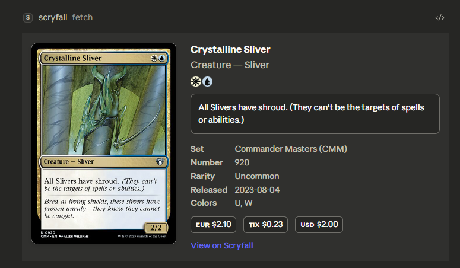

# Scryfall MCP Server

A community MCP server for searching and fetching Magic: The Gathering card data from [Scryfall](https://scryfall.com). Features an [MCP App](https://github.com/modelcontextprotocol/ext-apps) UI that renders card images, mana symbols, oracle text, and pricing when used in compatible hosts like Claude Desktop.

> **Note:** This is an independent community project. It is not affiliated with or endorsed by Scryfall.



## Tools

- **search** — Search for cards using [Scryfall full-text syntax](https://scryfall.com/docs/syntax) (e.g., `c:red t:creature cmc=3`, `set:mkm`, `o:"draw a card"`)
- **fetch** — Fetch full card details by Scryfall UUID. In MCP App-capable hosts, renders a card viewer UI with the card image, mana cost icons, oracle text, set info, rarity, and prices.
- **get_rule** — Look up the [Comprehensive Rules](https://magic.wizards.com/en/rules) by rule number: one subrule (`702.19b`), a rule and its subrules (`702.19`), or a section's contents (`702`)
- **search_rules** — Search the Comprehensive Rules and their glossary by keyword
- **get_rulings** — Get a card's Oracle text and its rulings, by Scryfall UUID or name

## Installation

### Option 1: MCPB (one-click install for Claude Desktop)

Download [`scryfall-mcp-server.mcpb`](https://github.com/olaservo/scryfall-mcp-app/releases/latest) from the latest release and open it in Claude Desktop.

### Option 2: npm

```json
{
  "mcpServers": {
    "scryfall": {
      "command": "npx",
      "args": ["-y", "@olaservo/scryfall-mcp-server"]
    }
  }
}
```

### Option 3: Build from source

```bash
git clone https://github.com/olaservo/scryfall-mcp-app.git
cd scryfall-mcp-app
npm install
npm run build
```

Then add to your `claude_desktop_config.json`:

```json
{
  "mcpServers": {
    "scryfall": {
      "command": "node",
      "args": ["/path/to/scryfall-mcp-app/dist/index.js"]
    }
  }
}
```

### Option 4: Remote, behind Google sign-in

`worker/` is a Cloudflare Worker that serves the same tools over HTTP to an allow-list of Google accounts. See [docs/remote.md](docs/remote.md).

## Development

```bash
npm run dev          # Watch mode with tsx
npm run build        # Build UI + server
npm run inspector    # Test with MCP Inspector
npm run pack         # Build .mcpb bundle
```

## How It Works

The server uses the [MCP Apps extension](https://github.com/modelcontextprotocol/ext-apps) to pair the `fetch` tool with a card viewer UI resource. When a card is fetched:

- **`content`** returns a readable text summary (card text, metadata, prices) for the model
- **`structuredContent`** sends the full card data to the UI for rendering
- The UI renders the card image, Scryfall mana symbol SVGs in the mana cost and oracle text, and card metadata
- CSP is configured to allow images from `cards.scryfall.io` and SVGs from `svgs.scryfall.io`
- Non-UI hosts receive the text fallback with all card details

## Rules and citations

The rules tools read the Comprehensive Rules text file that Wizards of the Coast links from [magic.wizards.com/en/rules](https://magic.wizards.com/en/rules). The server finds the file on the first rules call and checks the page for a new release once a day. If that check fails, it keeps serving the copy it has. Set `MTG_CR_URL` to use a specific file instead.

Every answer from `get_rule` and `search_rules` states the effective date of the rules it came from. Answers from all three rules tools carry citations in the format of [citation-audit-demo](https://github.com/olaservo/citation-audit-demo):

- The text has a `[cN]` marker after each quoted rule or ruling, and a link definition for each marker at the end.
- For a client that declares the `io.github.olaservo/citations` extension capability, `_meta["io.github.olaservo/citations"]` has one [SEP-3094](https://github.com/modelcontextprotocol/modelcontextprotocol/pull/3094) citation per marker: name, URL, the quoted text, publisher, and the rules' effective date or the ruling's date.

Rules citations link the dated rules file. Card citations link the card's Scryfall page.
